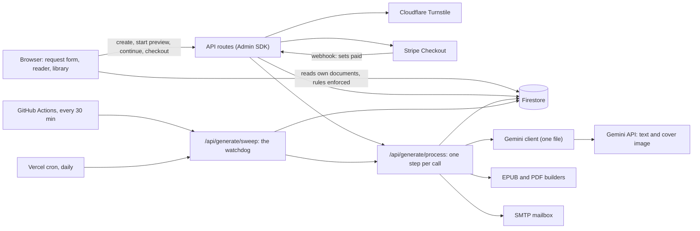
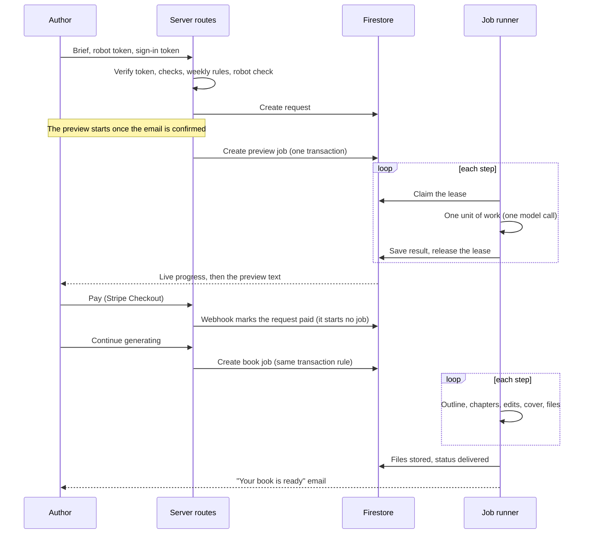
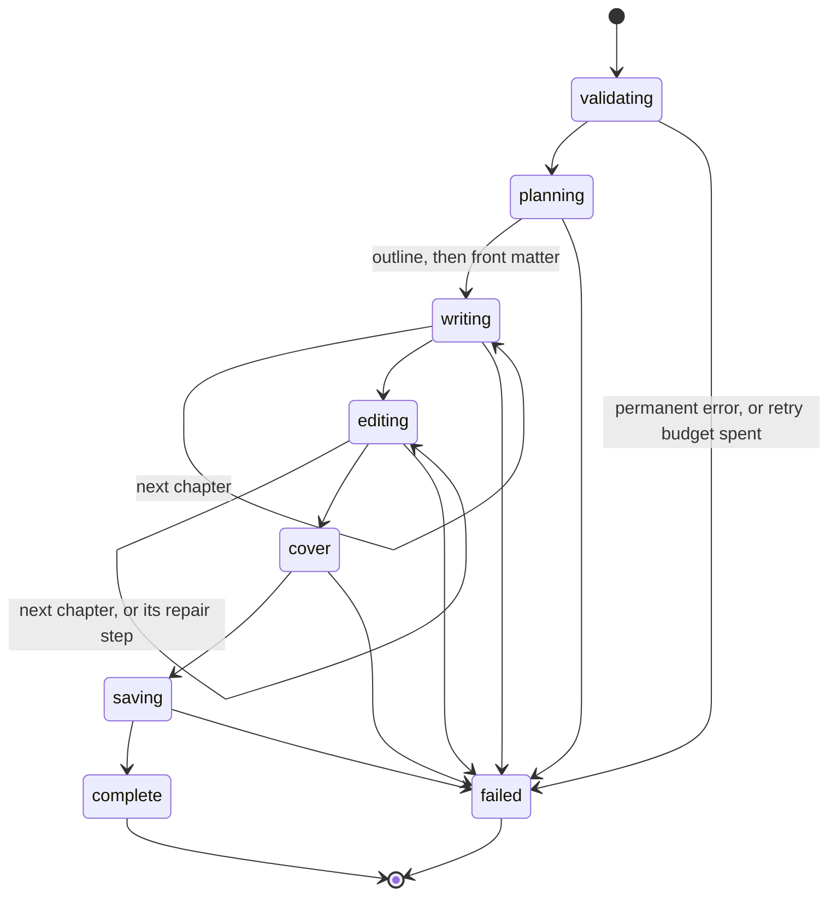

# Architecture

## Components

A Next.js app on Vercel serves the pages and the API routes. Firebase Auth identifies people and Firestore holds all state. The browser reads its own data from Firestore under security rules, and every change to a request or a job goes through a server route using the Admin SDK. The Gemini API is reached through one small client.

## From a brief to a book

Two decisions in that flow are deliberate. Payment only unlocks the book, and writing starts when the author presses "Continue generating", so nobody pays Gemini for a book the buyer has not asked for yet. And the free preview already plans the chapters and writes About the Author and the Introduction, so the paid book reuses exactly the contents list and opening pages the buyer was shown.

## The job system

A book is far too long for one function call, so the work is split into steps. A step is one chapter, one edit, one cover, and so on. The job document in Firestore holds the stage, the progress, the outline, the continuity notes and the lease. Chapter drafts are one document each, so a job never grows towards Firestore's 1 MB limit.

The free preview is its own, shorter job: planning, drafting, editing, an optional fixing step if the quality gate trips, saving. Both kinds are shown by the same progress card.

### One step, under a lease

`POST /api/generate/process` claims the job's next step in a transaction and answers at once. The work itself runs after the response.

- **Lease.** The claim writes `lease.expiresAt`. While a lease is live, every other trigger (the self-chain, the page, the watchdog) is a harmless no-op, so two workers can never pay for the same step. The lease lasts 330 seconds, longer than the platform's 300-second limit.
- **Deadline.** The step gets an abort signal that fires at 270 seconds, so a slow model call is stopped and retried instead of the platform killing the function without a trace. The last 30 seconds are for writing the outcome.
- **Retries.** Attempts are counted per step, not per job. Waits grow: none, none, 30 seconds, 2 minutes, 5 minutes, 15 minutes. That rides out about twenty minutes of provider trouble before the job fails. A short wait is served inside the call, and a long one is left to the watchdog so a function is never held open doing nothing.
- **Permanent errors.** Some failures cannot be fixed by trying again (a job for a book that was deleted, a full book that was not paid for, junk that got past the form). Those fail the job at once without using the retry budget.
- **Alerts.** A job that fails for good emails the admin with the book, the stage and the error. Junk rejected on purpose does not.
- **Self-chain.** When a step finishes and more work remains, it triggers the next step through the app's public address. A lost trigger is not a lost job, because the watchdog finds running jobs nobody holds.

### The watchdog

`GET /api/generate/sweep` is protected by a shared secret and refuses to run without one. Each run:

1. nudges running jobs with no live lease and a retry wait that has passed;
2. starts previews that were approved but whose job never got created;
3. starts books that the author confirmed and paid for but whose job never got created;
4. re-sends "your book is ready" emails that were lost;
5. erases IP addresses and browser ids older than 90 days.

While any job is running it schedules its own next run four minutes later, behind a lock document that holds a token, so only one loop is ever alive. Vercel's free plan allows a cron once a day, so two outside clocks (a daily Vercel cron and a GitHub Actions schedule every 30 minutes) only have to revive the loop if it dies.

### Cost is recorded, not guessed

Every Gemini call, including one that fails or is aborted, reports its token counts. The runner adds them to the job with atomic increments and converts them to a cost with the published rates (input, output including thinking tokens, and per image). The cost of any preview or book can be read off its job document.

## The Gemini client

`src/lib/ai/gemini.js` is the only module that talks to the model, so retry rules, limits and the secret key live in one place and the rest of the code calls one function.

- It streams the response, so the page can show real progress while a chapter is written.
- Thinking parts are dropped from the text.
- A reply is accepted only if it finished with `STOP`. Running out of tokens, a safety stop and a connection that ended early are all errors, never a shorter book.
- A busy service (429, 5xx) gets one quick retry that follows the delay Google suggests. Anything longer is the job's own retry.
- The output limit is 32,768 tokens because thinking tokens count against it. A limit of 8,192 once produced a 277-word "2,000 word" preview.

## The quality gate

`src/lib/build/gate.js` runs on every edited chapter and on the generated front matter. It checks what a regular expression can decide: the dash family (em, en used as a dash, spaced hyphens, double and triple hyphens), leftover markers (`[VERIFY]`, `TODO`, `[INSERT]`) and a list of machine-voice words and phrases. A violation causes one targeted repair call. If the repaired text still fails, the step fails and is retried or the job fails. Nothing that fails the gate is saved as finished. Rules that need judgement are left to the prompt and are deliberately not faked with a regex.

## Data and access rules

| Collection | Who can read | Who can write |
|---|---|---|
| `users/{uid}` | the person, admins | the person (create, update) |
| `requests/{id}` | the owner, admins | the server only |
| `requests/{id}/files/*` and `chunks/*` | admins, or the owner once `paid` is true | the server only |
| `generationJobs/{id}` | the owner, admins | the server only |
| `generationJobs/{id}/chapters/*` | nobody in the browser | the server only |
| `supportTickets/{id}` | the submitter, admins | the server only |

Because the browser cannot write to `requests`, a visitor cannot set `paid`. Finished books are stored as base64 chunks in Firestore and gated by the same rule, so a file is unreachable until payment. Unfinished chapter drafts are never readable from the browser, because they are the paid product before it is unlocked.

## Cost and abuse controls

| Control | Where |
|---|---|
| Confirmed email, and a robot check verified inside the route, before any model spend | `api/requests/create`, `lib/captcha.js` |
| One free preview per connection, browser and disguised email per week; one unpaid preview per account, replaceable once a week | `lib/previewGate.js` |
| Throwaway email domains refused, Gmail dots and plus tags collapsed | `lib/emailRules.js` |
| Minimum length, and one long message pasted into several fields is spam | `lib/requestValidation.js` |
| A full book runs only when paid, or started by an admin | `api/generate/process` |
| Price computed from the stored request, never from the client | `api/checkout`, `lib/pricing.js` |
| Stripe webhook signature verified | `api/stripe-webhook` |
| IP addresses and browser ids erased after 90 days | `api/generate/sweep` |
| A finished book is never written twice | `ai/kickoff.js` |

## Choices worth knowing about

- **Firebase tokens are verified with `jose` directly.** `firebase-admin/auth` pulls in a dependency chain that crashes Vercel's bundler, so the server checks the token's signature, issuer and audience against Google's public keys itself. See the engineering log for how this was found.
- **The app calls itself through its public address.** Vercel's per-deployment addresses sit behind deployment protection and answer 401 to server-to-server calls. The first version used one and no job could pass its first step.
- **The stage list has a `review` stage that is not used.** It is reserved in the progress bands and has no code behind it.

## What I would improve next

- Test the routes and a whole book against the Firestore emulator and a fake Gemini server. The Gemini client is behind one function, so a fake server is easy.
- Add browser tests for the request form and the reader, which have none.
- Move the delivery files to Cloud Storage with signed links once there is budget for it.
- Make a chapter that is far off its word budget trigger a repair instead of only a warning.
- Fix the three lint findings, then make lint a gate in CI.
